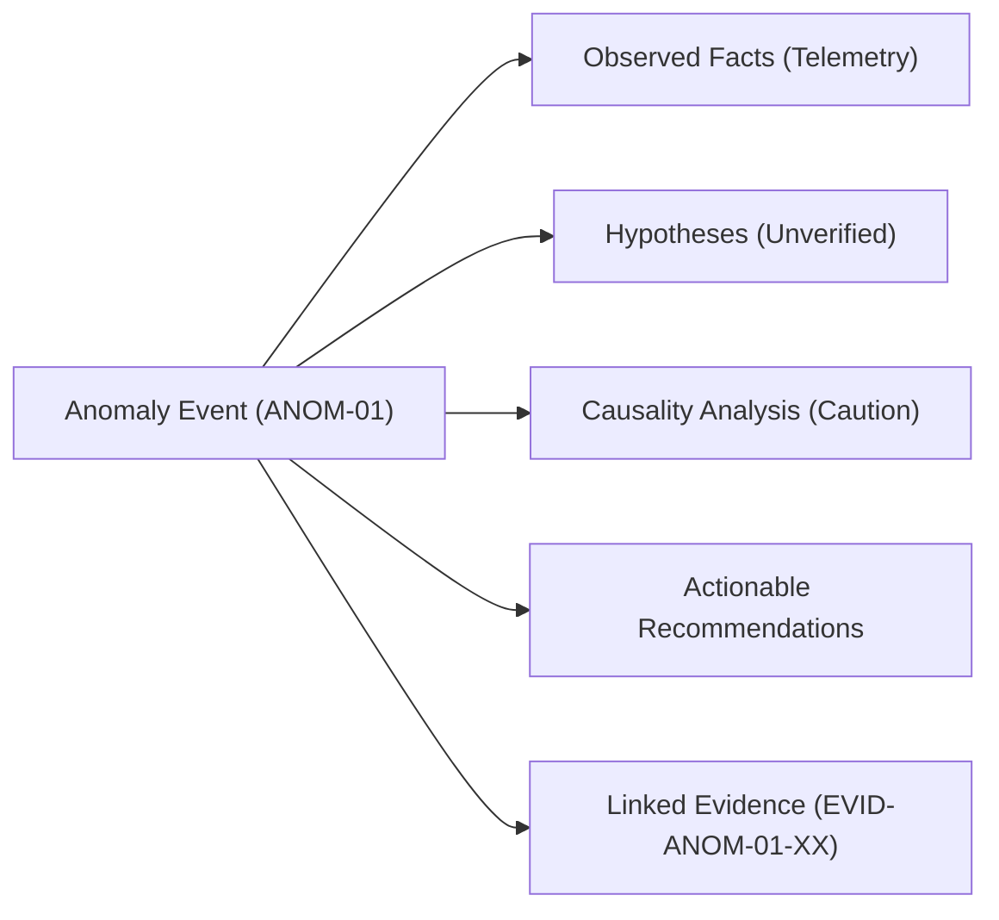
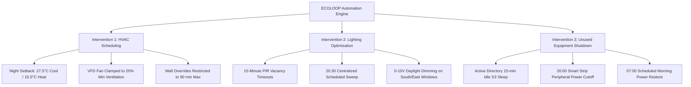

# ECOLOOP Data Dictionary & Technical Specification
## Synthetic Campus Building Energy Dataset — Fictional Building A

> [!IMPORTANT]
> **SYNTHETIC DEMO DATA NOTICE:**  
> All data points, measurements, equipment telemetry, baseline estimates, and diagnostic log messages in this dataset are **100% synthetically generated** for the **ECOLOOP** college hackathon prototype. No real campus or DSU facility measurements are represented. Do not treat these values as empirical physical measurements of any real-world structure.

---

## 1. Facility & Modeling Assumptions

| Attribute | Specification | Notes |
| :--- | :--- | :--- |
| **Building Identifier** | `BUILDING_A` | Fictional Science & Engineering Hall |
| **Gross Floor Area** | 45,000 sq ft (~4,180 m²) | 3 Floors: Classrooms, Computer Labs, Maker Space, Faculty Offices |
| **Peak Occupancy Capacity** | 250 Persons | Typical weekday peak ~210–225 students & staff |
| **Primary HVAC System** | VAV with central AHU-1 & Chilled Water Loop | Natural gas hot water boiler for hydronic reheat |
| **Primary Lighting** | LED high-bays (Atrium) & 0-10V dimmable troffers | DALI / centralized relay circuit architecture |
| **Primary Plug Loads** | 120 Desktop Workstations (40 GPU CAD/Sim units) | 3D printers, laser cutters, AV gear, office appliances |
| **Measurement Interval** | Hourly (60 minutes) | ISO 8601 UTC timestamp format (`YYYY-MM-DDTHH:MM:SSZ`) |
| **Reporting Units** | Energy: **kWh**, Power: **kW**, Temp: **°C** | All energy readings strictly non-negative ($\ge 0$) |
| **Dataset Horizon** | 14 Days (336 consecutive hourly records) | Week 1: Baseline + Anomalies; Week 2: Post-Interventions |
| **Grid Emissions Blend** | 0.385 kg CO₂e / kWh | Regional college grid emissions factor |
| **Electricity Tariff** | $0.12 / kWh | Standard commercial institutional blended rate |

---

## 2. Shared Data Schema & Field Definitions

Every record in [synthetic_building_a_energy.csv](file:///c:/Users/hp/ecoloop/data/synthetic_building_a_energy.csv) and [synthetic_building_a_energy.json](file:///c:/Users/hp/ecoloop/data/synthetic_building_a_energy.json) shares the standard schema below:

| Field Name | Type | Unit | Nullable | Description & Constraints | Example Value |
| :--- | :--- | :--- | :--- | :--- | :--- |
| `building_id` | String | — | No | Unique campus building identifier code. Constant `BUILDING_A`. | `"BUILDING_A"` |
| `timestamp` | String (ISO 8601) | UTC | No | Start of the hourly integration interval in ISO 8601 format. | `"2026-10-02T23:00:00Z"` |
| `kwh` | Float | kWh | No | Actual observed energy consumed during the hour. Non-negative ($\ge 0$). Shared field alias for `actual_kwh`. | `91.80` |
| `actual_kwh` | Float | kWh | No | Actual metered electrical consumption during the hour. Non-negative. | `91.80` |
| `expected_kwh` | Float | kWh | No | Model-predicted energy consumption under active operational schedule and weather conditions. Non-negative. | `29.80` |
| `baseline_kwh` | Float | kWh | No | Reference un-optimized historical baseline consumption for the same diurnal and ambient weather conditions. Non-negative. | `29.80` |
| `subsystem` | String (Enum) | — | No | Primary building subsystem driving or targeted by the hour's load: `BASELOAD`, `HVAC`, `LIGHTING`, `PLUG_LOAD`, `MIXED`, or `ALL_SYSTEMS_OPTIMIZED`. | `"HVAC"` |
| `occupancy_count` | Integer | Persons | No | Estimated concurrent human occupancy derived from Wi-Fi association counters and turnstile telemetry ($\ge 0$). | `0` |
| `outdoor_temp_c` | Float | °C | No | Ambient outdoor dry-bulb temperature recorded by the campus weather station. | `14.3` |
| `anomaly_flag` | Boolean | — | No | `true` if an operational fault, schedule overrun, or waste anomaly was active; `false` otherwise. | `true` |
| `anomaly_type` | String (Enum) | — | No | Categorical anomaly taxonomy: `NONE`, `HVAC_OFF_HOURS_OVERRUN`, `UNOCCUPIED_LIGHTING_OVERNIGHT`, `AFTER_HOURS_EQUIPMENT_DRAIN`. | `"HVAC_OFF_HOURS_OVERRUN"` |
| `intervention_active` | String (Enum) | — | No | Operational policy active: `BASELINE_NONE` (Week 1) or `ALL_INTERVENTIONS` (Week 2). | `"BASELINE_NONE"` |
| `evidence` | String | — | No | Descriptive telemetry, sensor readings, access logs, or control system state proving why an anomaly occurred or how savings were realized. | *(See Section 3 & 4)* |

---

## 3. Anomalies & Linked Diagnostic Evidence Records

The dataset models three realistic campus energy waste incidents during Week 1 (Pre-Intervention period). Under the ECOLOOP data contract, each anomaly strictly separates **Observed Facts** from **Hypotheses** and **Prescriptive Recommendations**, enforces an explicit **Correlation vs. Causation Caution**, and directly links to atomic evidence records in [`data/evidence_records.json`](file:///c:/Users/hp/ecoloop/data/evidence_records.json):



### Anomaly 1: HVAC Off-Hours Schedule Overrun
* **Incident ID:** `ANOM-01` | **Subsystem:** `HVAC` | **Location:** Zone 101 Lecture Hall & Mechanical Room
* **Reporting Period:** `2026-10-02T23:00:00Z` to `2026-10-03T05:00:00Z` (7 hours)
* **Energy Impact:** Observed mean: ~91.8 kWh/hr vs Normal baseline: ~29.8 kWh/hr (**437.8 kWh excess**)
* **Simulated Flag:** `is_simulated: true` | `data_classification: "SIMULATED_DEMO_DATA"`
* **Observed Facts (Empirical Sensor Data):**
  1. Sub-meter `MTR-HVAC-01` registered continuous 90.2 – 93.8 kW load.
  2. BMS point `BLDG_A.AHU1.FAN_CMD` commanded 100% VFD fan speed.
  3. Chilled water pump `PMP-CHW-02` operated at 100% duty with supply/return $\Delta T = 5.8^\circ\text{C}$.
  4. Wall thermostat `TH-101` registered `OVERRIDE_ACTIVE=TRUE` with setpoint at 18.0°C.
  5. Wi-Fi AP association count and turnstile entries in Zone 101 were 0.
  6. Ambient outdoor dry-bulb temperature was mild (11.9°C to 14.3°C).
* **Diagnostic Hypotheses (Unverified Inferences):**
  * *Primary:* An occupant engaged the 18.0°C wall override on Friday evening, bypassing central BMS setback.
  * *Secondary:* Central controller failed to send nightly setback packet due to bus communication drop.
* **Correlation vs. Causation Caution:**
  > [!CAUTION]
  > **Epistemic Notice:** The concurrent state of `OVERRIDE_ACTIVE=TRUE` and 100% AHU-1 load demonstrates temporal correlation but does not constitute proof of sole physical causation. Damper mechanical stiction, economizer actuator failure, or frozen freeze-stat contacts cannot be excluded without physical inspection.
* **Actionable Recommendations:**
  1. *Software:* Enforce 90-minute auto-reset timeout in central BMS for all local overrides.
  2. *Hardware:* Install lockable thermostat guard over unit TH-101.
  3. *Operational:* Program automated midnight pump sweep de-energizing chillers when outdoor temp < 15°C and occupancy = 0.
* **Linked Evidence Records:** [`EVID-ANOM-01-01`](file:///c:/Users/hp/ecoloop/data/evidence_records.json) through `EVID-ANOM-01-05` (BMS BACnet, Sub-meter, Wall Thermostat, Pump Status, Weather Station).

---

### Anomaly 2: Lighting Left On in Unoccupied Area
* **Incident ID:** `ANOM-02` | **Subsystem:** `LIGHTING` | **Location:** Zone 3 Central Atrium & 3rd Floor Classrooms
* **Reporting Period:** `2026-10-04T01:00:00Z` to `2026-10-04T07:00:00Z` (7 hours)
* **Energy Impact:** Observed mean: ~47.2 kWh/hr vs Normal baseline: ~24.4 kWh/hr (**159.2 kWh excess**, +22.8 kW constant draw)
* **Simulated Flag:** `is_simulated: true` | `data_classification: "SIMULATED_DEMO_DATA"`
* **Observed Facts (Empirical Sensor Data):**
  1. Lighting branch sub-meter `MTR-LTG-PNL3` measured steady 22.8 kW consumption (unoccupied baseline <1.5 kW).
  2. Relay controller `LCP-03` reported relays 1 through 12 in state `CLOSED_MANUAL`.
  3. Ceiling PIR occupancy sensors logged 0 motion events across all 7 hours.
  4. Access control `ACS-BLDGA-MAIN` recorded perimeter armed and locked since Saturday 22:30.
* **Diagnostic Hypotheses (Unverified Inferences):**
  * *Primary:* Custodial maintenance staff completed floor buffing at 22:30 and left the keyed master override engaged.
  * *Secondary:* Lighting contactor coil welded or DALI gateway freeze maintained closed circuit contacts.
* **Correlation vs. Causation Caution:**
  > [!CAUTION]
  > **Epistemic Notice:** The coincidence between custodial shift completion and continuous panel load suggests manual key switch bypass, but controller relay latch failure or bus freeze cannot be eliminated without physical voltage verification at the panel.
* **Actionable Recommendations:**
  1. *Software:* Deploy centralized 03:00 automated software lighting sweep to force off-pulse to all non-emergency contactors.
  2. *Hardware:* Replace maintained key switches with spring-return momentary switches requiring automated 120-min re-validation.
  3. *Operational:* Add lighting panel visual inspection to custodial shift checklists.
* **Linked Evidence Records:** [`EVID-ANOM-02-01`](file:///c:/Users/hp/ecoloop/data/evidence_records.json) through `EVID-ANOM-02-04` (Relay Panel, Sub-meter, PIR Sensors, Access Control).

---

### Anomaly 3: Equipment Remaining Active After Operating Hours
* **Incident ID:** `ANOM-03` | **Subsystem:** `PLUG_LOAD` | **Location:** Room 202 (CAD & 3D Simulation Lab)
* **Reporting Period:** `2026-10-05T20:00:00Z` to `2026-10-06T04:00:00Z` (9 hours)
* **Energy Impact:** Observed: ~67.8 descending to ~56.5 kWh/hr vs Normal baseline: ~38.5 to ~28.0 kWh/hr (**255.4 kWh excess**)
* **Simulated Flag:** `is_simulated: true` | `data_classification: "SIMULATED_DEMO_DATA"`
* **Observed Facts (Empirical Sensor Data):**
  1. Dedicated lab panel `MTR-PLUG-R202` measured continuous 28.5 kW active load.
  2. Active Directory domain controller reported 0 active interactive logon sessions after 19:45.
  3. Network switch `SW-R202-01` showed 40 host ports active at 1 Gbps with background keep-alives (~1.2 Mbps).
  4. Room 202 RFID badge reader recorded 0 door accesses after 19:48.
  5. Smart PDU telemetry logged three 3D printer bed heaters at constant 60.0°C standby.
* **Diagnostic Hypotheses (Unverified Inferences):**
  * *Primary:* Workstations had local OS sleep disabled ("Never Sleep" profile), leaving 40 towers drawing 200W active idle alongside 3 standby 3D printer beds.
  * *Secondary:* Distributed unattended student render jobs or automated software image deployments were running.
* **Correlation vs. Causation Caution:**
  > [!CAUTION]
  > **Epistemic Notice:** The absence of interactive user sessions correlates with workstation idle state, but does not distinguish between unmanaged OS sleep settings versus active background batch rendering processes without inspecting CPU/GPU utilization and process tables.
* **Actionable Recommendations:**
  1. *Software:* Deploy Active Directory GPO enforcing 15-minute idle timeout to S3 sleep across all lab workstations.
  2. *Hardware:* Install smart scheduled relay power strips for lab bench peripherals configured for automatic 20:00 cutoff.
  3. *Operational:* Implement automated nightly maintenance wake-on-LAN followed by forced sleep command at 02:00.
* **Linked Evidence Records:** [`EVID-ANOM-03-01`](file:///c:/Users/hp/ecoloop/data/evidence_records.json) through `EVID-ANOM-03-04` (Sub-meter, Active Directory, Network SNMP, Smart PDU).

---

---

## 4. The Three ECOLOOP Interventions

On `2026-10-08T00:00:00Z`, three coordinated efficiency and automation interventions were rolled out:



### Intervention 1: Automated HVAC Scheduling & Temperature Setback (`INT-01`)
* **Control Mechanism:** Automated BMS logic enforcing nighttime setbacks on weekdays between 21:00 and 06:00 and on weekends between 18:00 and 08:00. Unoccupied cooling setpoint is relaxed to 27.5°C (up from 21.0°C) and heating setpoint is lowered to 15.5°C. AHU-1 variable frequency drive (VFD) supply fan speed is restricted to a 20% minimum ventilation baseline. Digital wall thermostat overrides are locked to a strict 90-minute maximum auto-reset timeout.
* **Weekly Subsystem Baseline:** 5,820.0 kWh
* **Weekly Observed Savings:** **2,168.4 kWh** (37.3% reduction in HVAC load)

### Intervention 2: PIR Occupancy Sweeps & Daylight Dimming (`INT-02`)
* **Control Mechanism:** Installation and recommissioning of dual-technology Passive Infrared (PIR) and ultrasonic vacancy sensors in all classrooms and lecture halls with a 15-minute auto-off timeout. A centralized DALI/relay controller automatically sweeps all non-emergency lighting off at 20:30 each evening. Ambient photo-sensors dynamically dim window perimeter fixtures by up to 60% during bright daytime hours. Custodial manual overrides are time-locked to 60 minutes.
* **Weekly Subsystem Baseline:** 2,940.0 kWh
* **Weekly Observed Savings:** **1,318.2 kWh** (44.8% reduction in lighting load)

### Intervention 3: Workstation Sleep Policies & Smart Plug Strips (`INT-03`)
* **Control Mechanism:** Campus Active Directory Group Policy Objects (GPOs) applied to all 120 desktop lab machines to force S3 low-power sleep state (<3W) after 15 minutes of user inactivity. Installation of scheduled smart relay power strips cutting 100% of phantom standby load from maker space bench equipment (3D printers, soldering irons, monitor displays) daily from 20:00 to 07:00.
* **Weekly Subsystem Baseline:** 3,180.0 kWh
* **Weekly Observed Savings:** **1,482.6 kWh** (46.6% reduction in off-hours plug loads)

---

## 5. Before-and-After Energy & Emissions Analysis

Using **IPMVP Option C (Whole Facility Energy Model)**, Week 1 (Oct 01 – Oct 07) represents the pre-intervention baseline, while Week 2 (Oct 08 – Oct 14) demonstrates post-intervention verification:

| Metric | Pre-Intervention (Week 1) | Post-Intervention (Week 2) | Absolute Delta | Percentage Change |
| :--- | :--- | :--- | :--- | :--- |
| **Historical Baseline Energy** | 11,940.0 kWh | 11,940.0 kWh | — | — |
| **Model Predicted Energy** | 11,940.0 kWh | 6,860.0 kWh | -5,080.0 kWh | -42.55% predicted |
| **Actual Observed Energy** | **12,792.4 kWh** | **6,970.8 kWh** | **-5,821.6 kWh** | **-45.51% vs W1 actual** |
| **Unnecessary Anomaly Waste** | 852.4 kWh | 0.0 kWh | -852.4 kWh | -100.0% eliminated |
| **Net Weekly Observed Savings** | — | **4,969.2 kWh** | — | **-41.62% vs baseline** |
| **Model Prediction Accuracy** | — | 97.82% | -110.8 kWh variance | -2.18% model error |
| **Avoided Carbon Emissions** | — | **1,913.1 kg CO₂e** | — | ~99.5 MT CO₂e / yr |
| **Weekly Financial Savings (@ $0.12/kWh)** | — | **$596.30** | — | **~$31,008 / yr** |

### Individual Intervention Breakdown

| Intervention ID | Target Subsystem | Baseline (kWh) | Predicted Savings (kWh / %) | Observed Savings (kWh / %) | Model Variance (%) | Financial Savings ($) | Avoided Carbon (kg CO₂e) |
| :--- | :--- | :--- | :--- | :--- | :--- | :--- | :--- |
| `INT-01` | HVAC Scheduling | 5,820.0 | 2,210.0 (38.0%) | 2,168.4 (37.3%) | -1.88% | $260.21 | 834.8 |
| `INT-02` | Lighting Optimization | 2,940.0 | 1,350.0 (45.9%) | 1,318.2 (44.8%) | -2.36% | $158.18 | 507.5 |
| `INT-03` | Equipment Shutdown | 3,180.0 | 1,520.0 (47.8%) | 1,482.6 (46.6%) | -2.46% | $177.91 | 570.8 |
| **Total** | **All Systems** | **11,940.0** | **5,080.0 (42.6%)** | **4,969.2 (41.6%)** | **-2.18%** | **$596.30** | **1,913.1** |

---

## 6. How Teammates Can Consume and Use This Dataset

This repository provides three data files formatted for direct use in the ECOLOOP prototype:

1. **[synthetic_building_a_energy.csv](file:///c:/Users/hp/ecoloop/data/synthetic_building_a_energy.csv)**: Complete 336-row hourly tabular dataset with all metrics, telemetry, and evidence strings.
2. **[synthetic_building_a_energy.json](file:///c:/Users/hp/ecoloop/data/synthetic_building_a_energy.json)**: Structured JSON payload containing facility metadata, KPI summaries, reference anomalies, reference interventions, and sample records.
3. **[interventions_summary.json](file:///c:/Users/hp/ecoloop/data/interventions_summary.json)**: Focused JSON specification of the three interventions and the complete Before-and-After M&V metrics.

### For Frontend Developers (UI, Dashboards & Charts)
* **Main Energy Time Series Chart:**
  * Plot `actual_kwh` as a solid line, `baseline_kwh` as a dashed gray reference line, and `expected_kwh` as a dotted line.
  * Highlight the date switch on `2026-10-08T00:00:00Z` with a vertical milestone marker: *"Interventions Deployed"*.
* **Anomaly Visualizer:**
  * Filter rows where `anomaly_flag === true`.
  * Highlight the anomaly time windows with red/amber shaded bands.
  * On hover or click, display the `evidence` and `anomaly_type` in a tooltip or inspector card.
* **Intervention Savings Cards:**
  * Ingest [interventions_summary.json](file:///c:/Users/hp/ecoloop/data/interventions_summary.json) to render KPI cards for:
    * Total Energy Saved: **4,969.2 kWh (-41.6%)**
    * Carbon Avoided: **1,913.1 kg CO₂e**
    * Cost Saved: **$596.30 / week ($31,000 annualized)**

### For Backend Developers (API Endpoints & Microservices)
* **Fast Data Ingestion:**
  * In Python / FastAPI / Flask:
    ```python
    import pandas as pd
    df = pd.read_csv("data/synthetic_building_a_energy.csv", parse_dates=["timestamp"])
    ```
  * In Node.js / Express:
    ```javascript
    const fs = require('fs');
    const energyData = JSON.parse(fs.readFileSync('data/synthetic_building_a_energy.json', 'utf8'));
    ```
* **Suggested API Endpoints to Mock:**
  * `GET /api/v1/buildings/BUILDING_A/readings?start=...&end=...` (Returns sliced hourly records)
  * `GET /api/v1/buildings/BUILDING_A/anomalies` (Returns filtered anomaly events with `evidence`)
  * `GET /api/v1/buildings/BUILDING_A/interventions` (Serves [interventions_summary.json](file:///c:/Users/hp/ecoloop/data/interventions_summary.json))

### For Machine Learning & Analytics Teammates
* **Baseline Regression & Anomaly Detection:**
  * Train an ordinary least squares (OLS) regression or Random Forest model on Week 1 non-anomalous hours using `outdoor_temp_c`, `occupancy_count`, and `hour_of_day` as features to predict `baseline_kwh`.
  * Calculate residual error $e_t = \text{actual\_kwh}_t - \hat{y}_t$. Values where $e_t > 3\sigma$ accurately trigger detection for `ANOM-01`, `ANOM-02`, and `ANOM-03`.

---

## 7. Sample Sustainability Dataset Specification (Multi-Resource)

For frontend and backend developers building cross-cutting campus sustainability widgets, the repository includes a curated sample sustainability dataset:
* **CSV:** [`data/sample_sustainability_dataset.csv`](file:///c:/Users/hp/ecoloop/data/sample_sustainability_dataset.csv)
* **JSON:** [`data/sample_sustainability_dataset.json`](file:///c:/Users/hp/ecoloop/data/sample_sustainability_dataset.json)
* **Linked Evidence Standalone:** [`data/evidence_records.json`](file:///c:/Users/hp/ecoloop/data/evidence_records.json)

### 7.1 Schema & Field Reference

| Field Name | Type | Unit | Nullable | Description | Example Value |
| :--- | :--- | :--- | :--- | :--- | :--- |
| `record_id` | String | — | No | Unique record identifier | `"SUS-ELEC-003"` |
| `timestamp` | String (ISO 8601) | UTC | No | Observation measurement time | `"2026-10-11T02:00:00Z"` |
| `location` | String (Generic) | — | No | Generic campus location identifier | `"Block A"`, `"Block B"`, `"Cafeteria"`, `"Library"`, `"Hostel 1"` |
| `resource_type` | String (Enum) | — | No | Resource stream category: `ELECTRICITY`, `WATER`, `WASTE` | `"ELECTRICITY"` |
| `unit` | String | — | No | Measurement unit: `kWh` (electricity), `litres` (water), `kg` (waste) | `"kWh"` |
| `observed_value` | Float | Unit | No | Actual observed/metered quantity ($\ge 0$) | `94.6` |
| `baseline_value` | Float | Unit | No | Standard operational expected baseline ($\ge 0$) | `29.0` |
| `variance_pct` | Float | % | No | Percentage difference: $((Obs - Base) / Base) \times 100$ | `226.21` |
| `anomaly_severity` | String (Enum) | — | No | Severity grade: `NONE`, `LOW`, `MEDIUM`, `HIGH`, `CRITICAL` | `"HIGH"` |
| `anomaly_explanation` | String | — | No | Diagnostic explanation or operational status note | `"Off-hours HVAC chiller overrun caused by manual wall thermostat override"` |
| `evidence` | String | — | No | Supporting sensor reading, diagnostic flag, or audit trail | `"Zone 101 thermostat override flag active at 18.0°C; AHU-1 fan at 100% capacity; 0 occupants."` |
| `source_type` | String (Enum) | — | No | Instrument origin: `SMART_METER`, `PULSE_FLOW_METER`, `SMART_SCALE`, `BMS_TELEMETRY`, `IOT_SENSOR`, `MANUAL_LOG` | `"BMS_TELEMETRY"` |
| `is_simulated` | Boolean | — | No | Simulation authenticity flag (strictly `true` for all demo records) | `true` |
| `data_classification` | String | — | No | Classification label: `"SIMULATED_DEMO_DATA"` | `"SIMULATED_DEMO_DATA"` |

### 7.2 Backend Endpoint Suggestions

* `GET /api/v1/sustainability/overview` — Returns rollup metrics across all 3 streams from `summary_metrics`.
* `GET /api/v1/sustainability/records?resource_type=WATER&severity=CRITICAL` — Filtered observations.
* `GET /api/v1/sustainability/anomalies/:id/evidence` — Linked supporting telemetry records.

